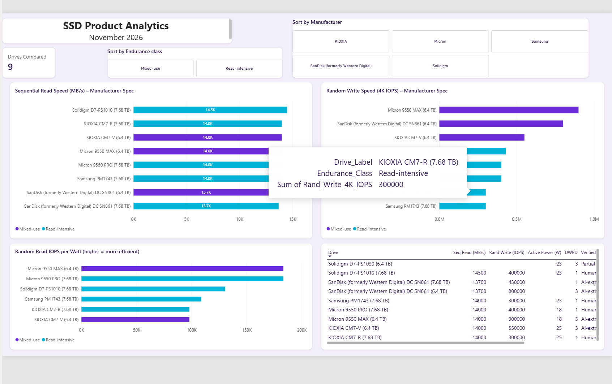

# SSD Product Analytics Dashboard

I built a Power BI dashboard to compare nine enterprise SSD configurations from five manufacturers: Solidigm, KIOXIA, Micron, Samsung, and SanDisk (formerly Western Digital). The dashboard helps product teams explain how performance, endurance, and power efficiency tradeoffs vary by workload.

*Power BI dashboard snapshot, November 2026.*

## What the dashboard shows

- **Manufacturer and endurance filters** let users narrow the comparison to a vendor or switch between read-intensive and mixed-use drives.
- **Sequential read throughput (MB/s)** shows how quickly each drive is rated to read contiguous data.
- **4K random write performance (IOPS)** compares how many small, non-sequential writes each drive is rated to handle per second.
- **Random read IOPS per watt** provides a way to compare read performance relative to active power where the inputs are available.
- **The drive-level table** shows active power, endurance in drive writes per day (DWPD), and verification status alongside performance specifications.

## Example comparison

| Configuration | Endurance class | Sequential read (MB/s) | 4K random write (IOPS) | Endurance (DWPD) |
| --- | --- | ---: | ---: | ---: |
| Solidigm D7-PS1010 (7.68 TB) | Read-intensive | 14,500 | 400,000 | 1 |
| Micron 9550 MAX (6.4 TB) | Mixed-use | 14,000 | 900,000 | 3 |

In this comparison, the Solidigm configuration has a higher rated sequential read speed, while the Micron configuration has higher rated random write performance and write endurance. The tradeoff is easier to communicate when these metrics are viewed together, especially when explaining which workloads are better served by each configuration.

## Data and scope

The throughput and random write charts use manufacturer specifications shown in the report. Published ratings can depend on capacity and test conditions, so treat them as a starting point for product comparison. The report flags verification status and shows blanks for some specifications.

This repository contains a static screenshot of the Power BI report. The editable Power BI file and underlying dataset are unavailable in this repository.
